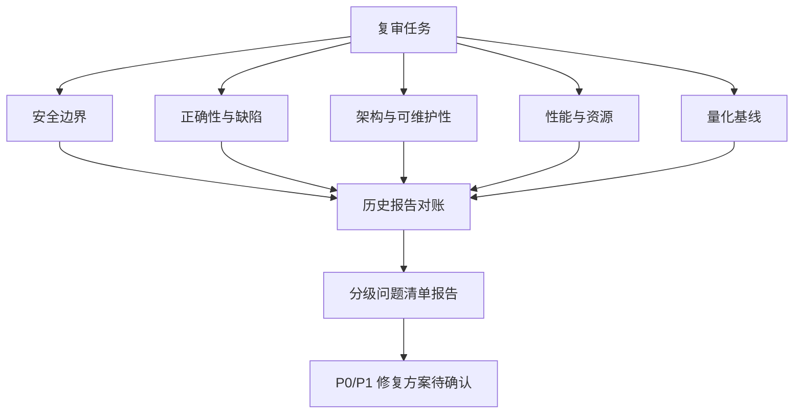

## 产品概述

对 `f:/新建文件夹/Lanyue-1.0.35`（揽乐 Lanyue v1.0.35，Electron 多平台音乐下载桌面应用）现有源码做一次全维度、全量复审，不改变产品功能，产出书面审查结论。

## 审查范围

- 代码：全量 `src/`（`main/` 含 `ipc/`、`mcp/`、`api/` 平台层、`utils/`、`renderer/`、`shared/`）+ `test/` + `scripts/` + `build/` 构建配置（约 240 个源文件、5 万行量级）
- 重点覆盖本版新增面：MCP 本地服务、AI 自然语言搜索聚合、loudnorm 转码、WebDAV 云同步、SQLite 下载历史迁移、酷狗 KRC 逐字歌词、换源 Range 预检、队列分平台并发钳制

## 核心审查维度

- 安全边界：Electron 安全三件套与子窗口、preload 暴露面、IPC 契约与鉴权、MCP 本地服务暴露面、SSRF/重定向 guard、目录沙箱、凭据三态存储、更新链路信任根
- 功能正确性与潜在缺陷：下载队列状态机与并发/续传、跨源换源与健康度排序、SQLite 历史迁移、WebDAV 合并与 ETag 乐观锁、歌词解码、AI 搜索去重聚合
- 架构与可维护性：超 1500 行巨型文件、模块耦合、平台插件契约一致性、重复实现、测试覆盖有效性
- 性能与资源：磁盘 IO 与写放大、文件监听、渲染层重绘、网络重试与限频、内存占用

## 产出

- 落盘一份简体中文复审报告（建议路径 `docs/CODE_REVIEW_2026-10-13.md`），沿用 `docs/CODE_REVIEW_2026-09-28.md` 的结构：结论摘要表 + 实测数据 + 值得肯定项 + 分级问题清单（每条须带「文件路径:行号」证据）+ 历史遗留项对账表 + 待确认的 P0/P1 修复方案
- 报告阶段禁止修改任何源码、测试、配置或提交；P0/P1 修复方案单独成节，经用户逐项确认后再实施

## 技术栈（沿用现有，不引入新依赖）

- Electron 44 + 原生 ES Module 渲染层 + Vite 5 + electron-builder 26
- `node:test` 单测（`node --test "test/*.test.js"`）、ESLint 9 flat config、`npm run verify` 全链路校验
- 审查手段仅限只读：文件阅读、ripgrep 检索、`code-explorer` 跨文件探索、LSP 符号/引用链追踪；验证类命令（`npx eslint` / `npm test`）只在用户确认修复阶段执行

## 实施方案

### 策略

采用「量化基线 → 四维度并行走查 → 历史基线对账 → 分级建档」的复审流程：先固化可复验的客观指标（文件数、行数、最大文件、lint/test 计数、产物体积），再按四个维度分别深入，每条结论必须能落到 `文件:行号` 证据，最后与 `docs/CODE_REVIEW_2026-09-17.md`、`docs/CODE_REVIEW_2026-09-28.md` 逐条对账，标注「已修 / 恶化 / 未处理 / 新引入」，避免重复劳动与失真归责。

### 关键技术决策

- **并行分域而非串行通读**：四个维度关注点不同、交叉引用少，分域并行可显著压缩时间；交叉点（如 `downloadQueue` 同时涉及正确性、性能、架构）由主审统一归并去重，避免同一问题重复计分。
- **先量化后判断**：所有「代码健康」「仓库卫生」评价都先拿实测数字（行数、用例数、单文件最大行数、工作区体积），数字与上一版同口径对比后再给评级，防止主观升降。
- **证据链至少两条**：单个文件内的可疑写法不算结论，需有「调用方如何使用」+「依赖/运行时真实行为」双证据（上一版 P1-1 正是靠 `electron-updater` 源码 + 产物实测 + `app-update.yml` 三者互证才立住）。
- **逐步向右上角抽样**：全部性唯象易失真，对 8 个平台插件采用「抽 2—3 个代表性插件（网易/酷狗/5sing）深入 + 其余以 manifest 字段与 gateway 能力推导核对」的方式覆盖，成本可控、结论可靠。
- **复用既有测评资产**：仓库已有 `check:dead-deps`、`check:icons`、`smoke:asar`、`update-signature-guard` 等守卫脚本与守卫测试，复审优先验证它们是否仍具约束力，而非另起炉灶。

### 各维度重点亲核点（经验确定的高风险区）

- 安全：`main/index.js` / `ipc/window.js` / `loginWindow.js` / `preload-secondary.js` 四处 Security 开关一致性；`preload.js` 暴露面与 `shared/ipcContract.js` 声明的一致性（是否存在「声明了没人注册」或「注册了没声明」）；`main/mcp/` 绑地址、Bearer 比较方式、Origin 校验、请求体上限、工具白名单是否仍排除凭据/文件写入/更新安装；`utils/urlGuard.js` 逐跳重定向 guard 是否仍覆盖降级剥离；`main/approvedDirs.js` 符号链接逃逸复核；`utils/secretStore.js` 三态与缓存策略
- 正确性：`main/downloadQueue.js` 并发钳制/终态落盘/重启续传状态机与竞态；`utils/crossSourceAggregate.js` + `sourceHealth.js` 换源 Range 预检失败降级路径；`utils/history.js` SQLite 迁移的幂等性、`history.json` 迁移后数据完整性与写入失败回滚；`utils/syncMerge.js` + `webdav.js` ETag 冲突合并与双向删除语义；`utils/krcCodec.js` 解密边界与异常输入；`utils/downloader.js` + `retry.js` 重试风暴与 Range 续传一致性
- 架构：行数超 1500 的视图层巨型文件（上版为 `renderer/js/views/local.js`、`app.js`）现状；平台插件 manifest 字段一致性、`api/gateway.js` 能力推导与 `pluginRegistry.js` 单一事实来源是否仍成立；重复实现排查（原子写、路径拼接、歌词解析等在 `utils/` 中的多份实现）
- 性能：`libraryWatcher.js` / `clipboardWatch.js` 监听粒度与去抖；`libraryIndex.js` 索引重建触发频率；渲染层列表重绘与 `addDlChangeListener` 类全量刷新；下载写盘的 IO 扇出与临时文件清理

### 覆盖面层级（便于分工与去重）



## 实施注意事项

- **只在必要时只读执行命令**：`Get-ChildItem` 统计行数、磁盘占用可用；`npm install`、构建、格式化一律不做。
- **Windows/PowerShell 环境约束**：换行已由 `.gitattributes` 统一 LF，复审不得再引入 CRLF 差异；任何「用正则断言源码文本」的守卫测试都要留意 `\n` 硬编码（上版 P1-2 的血泪）。
- **不能凭印象记事**：像 `verifyUpdateCodeSignature`（`build/config.cjs:131`）这类项，1.0.33→1.0.35 期间已新增 `useMirrorFeed` 信任闸门与 `update-signature-guard`、`update-trust-wording`、`update-mirror` 三份守卫测试，必须实测「空转是否仍成立、闸门是否 fail-closed」后再定级，不能沿用上一版结论。
- **爆炸半径控制**：报告阶段零改动；修复阶段每改一处必须补对应用例，并在收尾跑 `npm run lint`、`node --test "test/*.test.js"`，确保不破坏既有 2000+ 用例。
- **平台插件结论需可推广**：单个插件发现的问题，要评估其余 7 个是否存在同类模式，在报告中以「个例 + 通病」两层表述。

## 目录结构

本次为审查任务，产出物为报告文档；涉及的现有关键路径：

```
Lanyue-1.0.35/
├── docs/
│   ├── CODE_REVIEW_2026-09-17.md   # [参考] v1.0.19 基线报告，用于对账
│   ├── CODE_REVIEW_2026-09-28.md   # [参考] v1.0.33 基线报告，格式模板与遗留项来源
│   └── CODE_REVIEW_2026-10-13.md   # [NEW] 本次复审报告：摘要表 + 实测数据 + 四维度分级问题清单 + 历史对账 + 待确认修复方案
├── src/
│   ├── main/                       # [READ] 安全配置、下载队列、MCP、IPC、更新链路
│   ├── api/                        # [READ] 网关与 8 个平台插件契约
│   ├── renderer/                   # [READ] 视图层巨型文件与重绘热点
│   ├── utils/                      # [READ] 下载/历史/同步/加密/歌词等核心逻辑
│   └── shared/                     # [READ] IPC 契约单点
├── test/                           # [READ] 既有守卫测试有效性核对
├── build/config.cjs                # [READ] 打包与签名/更新信任配置
└── scripts/                        # [READ] 构建后处理与各类守卫脚本
```

修复阶段涉及文件需待报告确认后另行列出，本计划不预先指定。

## 使用的扩展

### SubAgent

- **code-explorer**：用于在 `src/main`、`src/utils`、`src/renderer`、`test` 中做 "very thorough" 级跨文件探索与统计（行数分布、巨型文件、重复实现、调用链），产出带行号的取证清单。
- 预期产出：每个维度一份「文件路径:行号 + 现象描述」的候选问题列表，供主审归并去重。

### Skill

- **improve-codebase-architecture**：用于架构与可维护性维度——定位超 1500 行巨型文件的职责边界、模块耦合热点、平台插件契约漂移与重复实现，给出可落地的拆分/ consolidating 建议。
- 预期产出：章节化的深化机会清单，含每项的成本、收益与迁移风险评级。
- **lsp-code-analysis**：用于精确符号导航——`ipcContract` 与实际 `ipc/register.js` 注册的通道对账、平台插件 manifest 字段引用链、`preload` 暴露 API 的全部调用方。
- 预期产出：契约漂移（声明未注册 / 注册未声明 / handler 缺失参数校验）的精确清单。
- **diagnose**：用于 P0/P1 修复阶段——对确认要修的问题按「复现 → 最小化 → 假设 → 插桩 → 修复 → 回归测试」循环处理，避免凭直觉改代码。
- 预期产出：每项修复有前置失败证据与后置通过证据，回归用例入仓。